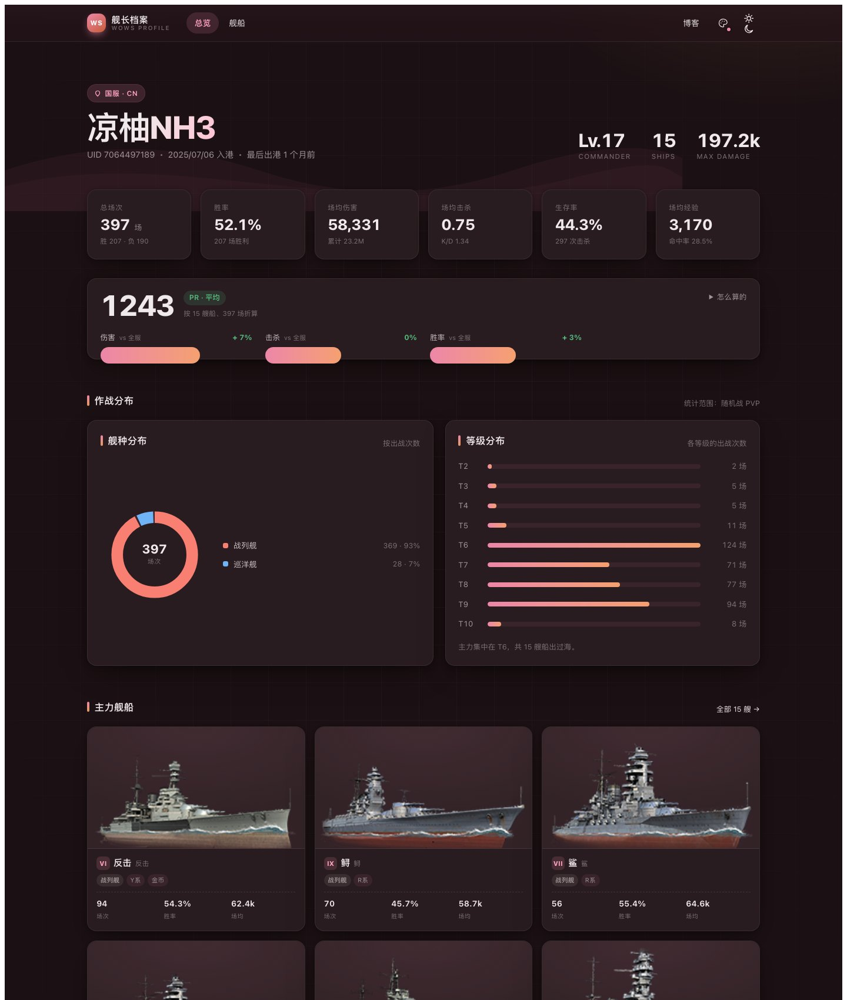
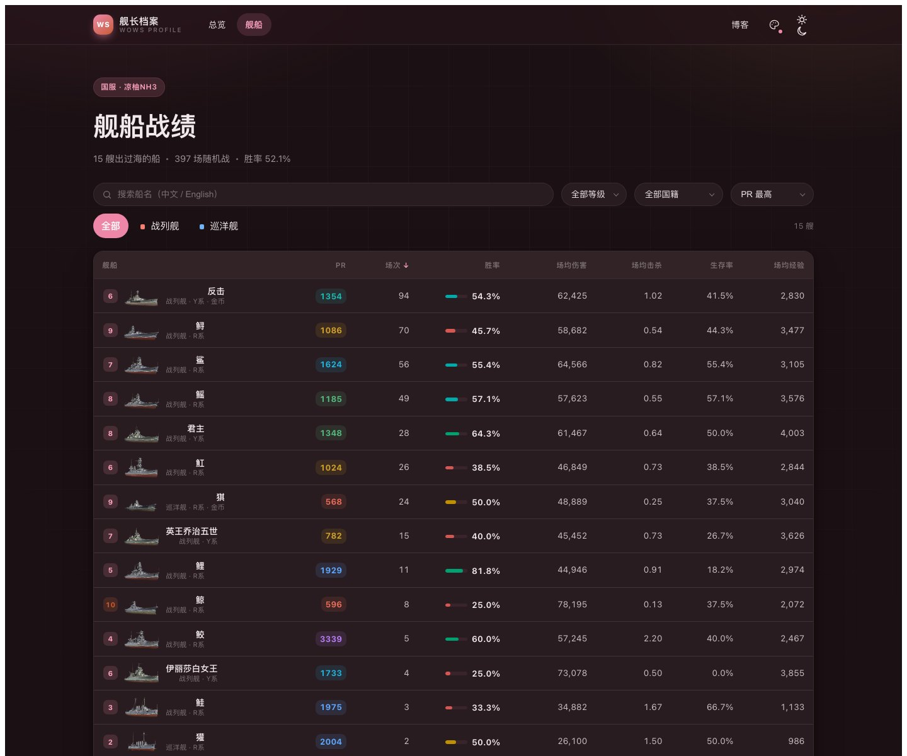

# wows-page

《战舰世界》个人战绩的静态页面，视觉对齐 [Firefly](https://github.com/Cydiar/Firefly) 博客主题。

数据在构建期抓成 JSON，运行时不发请求，也不需要密钥。

线上地址：<https://shaddocknh3.github.io/wows-page/>





## 目录

- [快速开始](#快速开始)
- [命令](#命令)
- [数据来源](#数据来源)
- [PR 评分](#pr-评分)
- [与博客的关系](#与博客的关系)
- [独立部署](#独立部署)
- [自定义](#自定义)
- [说明](#说明)

## 快速开始

需要 Node.js 20 以上，包管理器用 pnpm。

```bash
pnpm install
```

改 `wows.config.json`，填服务器和游戏 ID：

```json
{
	"realm": "cn",
	"nickname": "你的游戏 ID",
	"appId": ""
}
```

`realm` 可选 `cn` / `asia` / `eu` / `na` / `ru`。`appId` 只有国际服要填，国服留空。

然后抓数据、起服务：

```bash
pnpm fetch    # 会联网，产物写进 src/data/
pnpm dev      # http://localhost:4321
```

## 命令

| 命令 | 作用 |
| --- | --- |
| `pnpm fetch` | 抓账号与逐船战绩 |
| `pnpm baselines` | 抓全服基准（PR 用），四周一次就够 |
| `pnpm dev` | 本地预览 |
| `pnpm build` | 构建到 `dist/` |

抓到的 JSON 是提交进仓库的，所以 CI 不依赖网络也能构建。

## 数据来源

| 服务器 | 通道 | 要不要 key |
| --- | --- | --- |
| 国服（360） | Vortex 公开接口 `vortex.wowsgame.cn` | 不需要 |
| 亚服 / 欧服 / 美服 / 俄服 | 官方 API | 需要 |

国服走的是与官网图鉴同一套接口：搜索、账号、逐船战绩、舰船图鉴（GraphQL 全量 1044 艘）都能拿到。360 的开发者站常年打不开，所以这个项目完全没依赖它。

国际服把 key 放环境变量：

```bash
WOWS_APP_ID=xxxx WOWS_NICKNAME=你的ID WOWS_REALM=asia pnpm fetch
```

优先级：环境变量 > `wows.config.json`。key 在 <https://developers.wargaming.net/applications/> 申请，免费。

国服和国际服的 key 不通用，换服要重新申请。

两边的差异前端会自动适配，换服不用改代码：

| 项目 | 国服 | 国际服 |
| --- | --- | --- |
| 逐船最后战斗时间 | 接口没有，「最近出港」换成「武备效率」 | 有 |
| 舰船图鉴 | GraphQL 全量，版本跟客户端 | 官方 encyclopedia 接口 |

### 定时更新

`.github/workflows/update-data.yml` 每周一凌晨 02:00（UTC+8）抓一次，数据有变化才提交。

国服不需要任何 Secrets。国际服要配 `WOWS_APP_ID`、`WOWS_NICKNAME`，`WOWS_REALM` 可选。

不启用也一样，数据停在上一次手动抓取的快照。只改时间戳时不会产生提交。

## PR 评分

用的是 wows-numbers 公开的 Personal Rating 口径，实现照 [wows-yuyuko/WowsApi](https://github.com/wows-yuyuko/WowsApi) 的 `com.shinoaki.wows.api.pr.PrCalculation` 写：

```text
期望总伤害 = 场次 × 该船全服场均伤害
期望总击杀 = 场次 × 该船全服场均击杀
期望总胜场 = 场次 × 该船全服胜率

nd = 实际总伤害 / 期望总伤害
nf = 实际总击杀 / 期望总击杀
nw = 实际总胜场 / 期望总胜场

PR = 700 × max(0, (nd - 0.4) / 0.6)
   + 300 × max(0, (nf - 0.1) / 0.9)
   + 150 × max(0, (nw - 0.7) / 0.3)
```

账号总 PR 是把各船的实际值与期望值分别求和后再套一次公式，不是把每条船的 PR 取平均。

分档沿用 wows-numbers 的区间：2450 以上超神，2100 顶尖，1750 优秀，1550 良好，1350 不错，1100 平均，750 偏低，750 以下待提升。

### 基准值

wows-numbers 的期望值接口被 Cloudflare 挡着，改用 [wowsdb](https://wowsdb.com/zh-CN/player/rating) 采集的全服样本，约 49 万活跃账号、18 亿场随机战。

找不到同名船时（例如国服特有船），退到同舰种同等级的全服加权平均。

> 国服与国际服的船池、玩家分布都不一样，同一套基准套上去会偏低。看趋势比看绝对值靠谱。

## 与博客的关系

博客里已经内置了一份（`/wows/`），用的是同一套组件和同一份数据：
`src/components/pages/wows/WowsShips.svelte` 加 `src/data/wows/*.json`。

颜色全部由主题令牌提供 —— `--primary`、`--card-bg`、`--line-divider`、`--deep-text`、
`--content-meta`、`--btn-regular-bg`、`--radius-large`。所以组件两边能原样共用，
不用维护两套皮肤。本项目的 `src/styles/theme.css` 只干一件事：把这些变量映射到自己的 `--wows-*` 色板。

改版式时先改博客那份，再把 `WowsShips.svelte` 拷回来。唯一的差异是分页：博客用主题自带的
`ClientPagination`（依赖 i18n），这里是等宽的一对小按钮。

## 独立部署

自己跑一个站，带独立导航、页脚与双主题。

Vercel / Cloudflare Pages：框架预设选 Astro，构建命令 `pnpm build`，输出目录 `dist`。

GitHub Pages：`.github/workflows/deploy.yml` 已配好，Source 选 `GitHub Actions` 后每次 push 自动发布。项目站点会自动把 `BASE_PATH` 设成 `/<repo>`，绑自定义域名时改成 `/`。

> GitHub Pages 对私有仓库需要 Pro 订阅，仓库公开才能免费使用。

## 自定义

| 想改什么 | 改哪里 |
| --- | --- |
| 站点标题、默认主题、博客地址 | `src/config.ts` |
| 两套配色的色相 | `src/config.ts` 的 `themes` |
| 服务器、昵称 | `wows.config.json` |
| 配色变量、圆角、间距 | `src/styles/global.css` 顶部 |
| 指标口径、要展示哪些数据 | `scripts/fetch-wows.mjs` |

两套配色：`blog` 是玫粉（色相 360，与博客一致，默认），`wows` 是海军蓝（210）。导航栏的调色盘按钮切换，选择写进 `localStorage`，也能用 URL 参数指定：`?palette=wows`、`?theme=light`。

舰船页支持四种条件叠加：中英文船名搜索、舰种、等级（Tier 2–11）、国籍。排序可以点表头，也可以用下拉。

原生 `<select>` 的展开列表由系统绘制，CSS 改不动，深色页面里会弹一块系统灰，所以自己写了 `Select.astro`。

## 说明

- 数据来自 Wargaming / 360 的公开接口，只读，不涉及账号登录
- 与 Wargaming、360 无任何关联
- 战绩本身是公开信息，展示他人账号前建议先征得同意

## License

MIT
