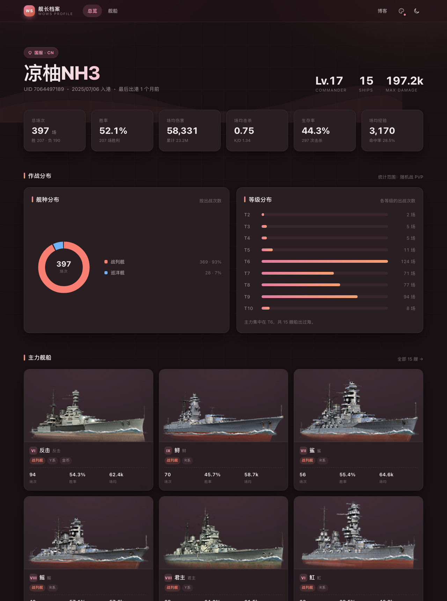
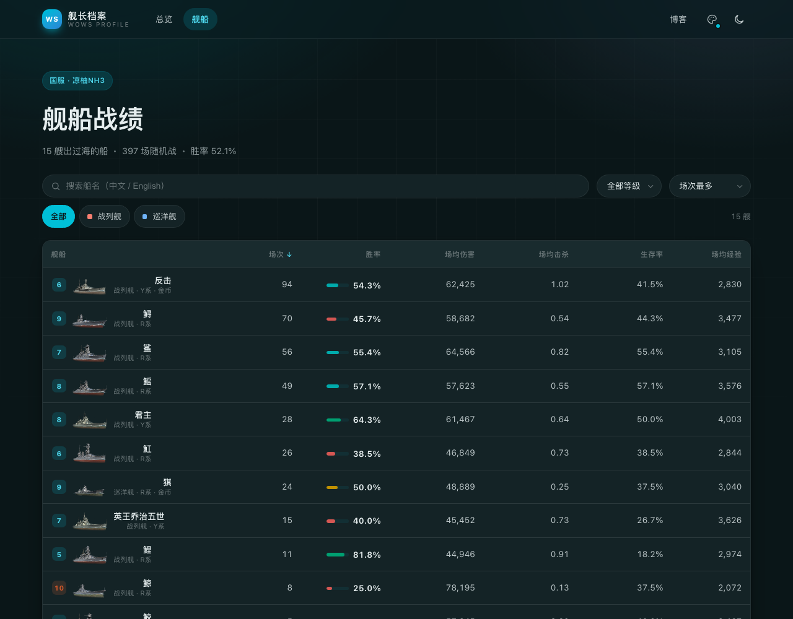

# wows-page

一个静态的《战舰世界》个人战绩页面 —— 展示自己的账号数据，风格对齐 [Firefly](https://github.com/Cydiar/Firefly) 博客主题。





- 纯静态：构建期就把数据抓成 JSON，运行时零请求、零 key
- 无框架运行时：Astro + 手写 CSS，产物只有几十 KB
- **两套配色**：`blog`（跟博客主题色一致）和 `wows`（海军蓝），导航栏一键切换，会记住选择
- 深浅色、响应式、可筛选的逐船战绩表
- 不改动博客本体，可独立部署，也可以挂在 `/wows/` 子路径

## 页面

| 路由 | 内容 |
| --- | --- |
| `/` | 账号总览：核心指标、舰种/等级分布、主力舰船、个人纪录、最近出港 |
| `/ships` | 逐船战绩表：搜索、按舰种/等级筛选、点表头排序 |

## 快速开始

```bash
pnpm install

# 1. 改 wows.config.json，填服务器和昵称（默认就是国服）
#    { "realm": "cn", "nickname": "你的游戏ID" }

# 2. 抓数据 —— 国服不需要任何 key
pnpm fetch

# 3. 本地预览
pnpm dev        # http://localhost:4321
pnpm build      # 产物在 dist/
```

### 关于 key：国服不用，国际服要

| 服务器 | 通道 | 需要申请吗 |
| --- | --- | --- |
| **国服（360）** | Vortex 公开接口 `vortex.wowsgame.cn` | **不需要**，`pnpm fetch` 直接跑 |
| 亚服 / 欧服 / 美服 / 俄服 | 官方 API | 需要，到 https://developers.wargaming.net/applications/ 免费申请 |

国服走的是和官网图鉴同一套 Vortex 接口（搜索、账号、单船、舰船图鉴），版本号都跟着客户端走；
国际服走官方 API，把申请到的 id 放环境变量即可：

```bash
WOWS_APP_ID=xxxx WOWS_NICKNAME=你的ID WOWS_REALM=asia pnpm fetch
```

优先级：环境变量 > `wows.config.json`。国服的 `developers.wggames.cn`（360 的开发者站）常年
打不开，所以压根没依赖它。

### 仓库里这份示例数据

`src/data/*.json` 是构建产物，直接提交进仓库（这样 CI 不依赖 key 也能构建）。
当前这份是国服号 `凉柚NH3` 的数据，跑一次 `pnpm fetch` 就会按配置重新生成。

### 定时更新数据

`.github/workflows/update-data.yml` 每周一凌晨跑一次抓取并提交 `src/data`：
- 国服不需要任何 Secrets，默认配置直接能跑
- 国际服需要在仓库 Secrets 里配 `WOWS_APP_ID`、`WOWS_NICKNAME`（`WOWS_REALM` 可选）

不启用也没关系，数据会停在最后一次手动抓取的状态。

## 部署

### GitHub Pages

推上去，在仓库 Settings → Pages 里把 Source 选成 GitHub Actions 即可，
`.github/workflows/deploy.yml` 会在每次 push 后自动构建发布。

项目站点的地址是 `https://<user>.github.io/wows-page/`，工作流里已经自动把
`BASE_PATH` 设成 `/wows-page`，不用手动改。

### Vercel / Cloudflare Pages

框架预设选 Astro，构建命令 `pnpm build`，输出目录 `dist`。部署在根路径就不用管 base。

## 挂到 Firefly 博客上

不想动博客源码的话，有两种方式：

1. **子路径**：把本站部署到 `blog.attilio.cc/wows/`（Vercel 上给同一个项目加 rewrite，
   或者单独部署后用 `rewrites` 转发），然后导航栏 `blogUrl` 反着指回去就行。
2. **独立域名**：本站单独部署，导航栏的「博客」按钮指回博客（改 `src/config.ts` 的 `blogUrl`）。

两种都不需要改博客的代码。

## 自定义

| 想改什么 | 改哪里 |
| --- | --- |
| 站点标题、默认主题、博客地址 | `src/config.ts` |
| 两套配色的色相 | `src/config.ts` 的 `themes` |
| 服务器、昵称 | `wows.config.json` |
| 配色变量、圆角、间距 | `src/styles/global.css` 顶部 `:root` |
| 指标口径、要展示哪些数据 | `scripts/fetch-wows.mjs` |

### 两套配色

| key | 色相 | 说明 |
| --- | --- | --- |
| `blog` | 360 | 玫粉，跟博客的 `themeColor.hue` 一致，默认 |
| `wows` | 210 | 海军蓝，更贴近游戏，圆角也收紧一点 |

导航栏那枚调色盘按钮切换，选完写进 `localStorage`，下次进来还是这套。
想加第三套就往 `themes` 里加一行，`data-theme` 会自动生成对应的 `--hue`。
URL 参数也能直接指定：`/?palette=wows`、`/?theme=light`，方便给别人看某个特定状态。

### 国服和国际服的数据差异

| | 国服（Vortex） | 国际服（官方 API） |
| --- | --- | --- |
| 申请 key | 不需要 | 需要 |
| 逐船最后战斗时间 | 接口没有，「最近出港」自动换成「武备效率」 | 有 |
| 舰船图鉴 | GraphQL 全量拿，版本跟客户端 | 官方 encyclopedia 接口 |

## 数据说明

- 数据来自 Wargaming / 360 的公开开发者 API，只读，不涉及账号登录。
- 本站与 Wargaming、360 无任何关联。
- 战绩数据本身是公开信息，但如果是别人的号，建议先征得同意再展示。

## License

MIT
